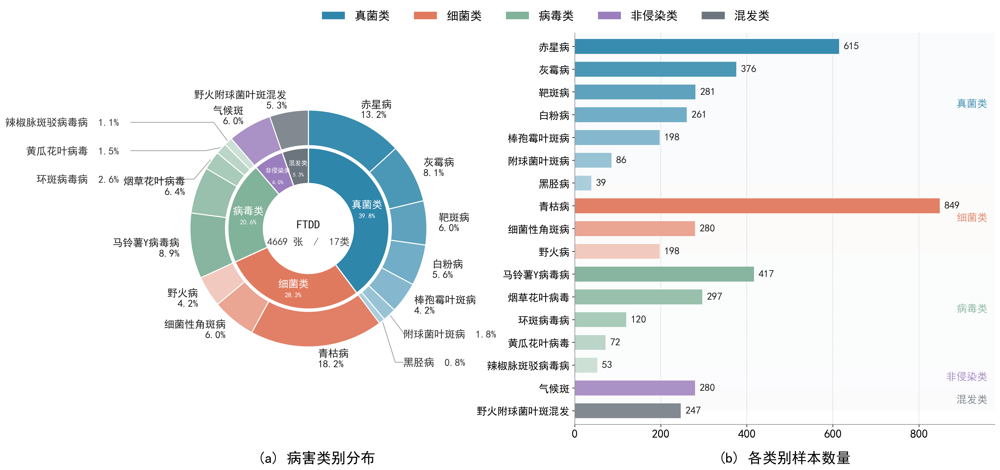
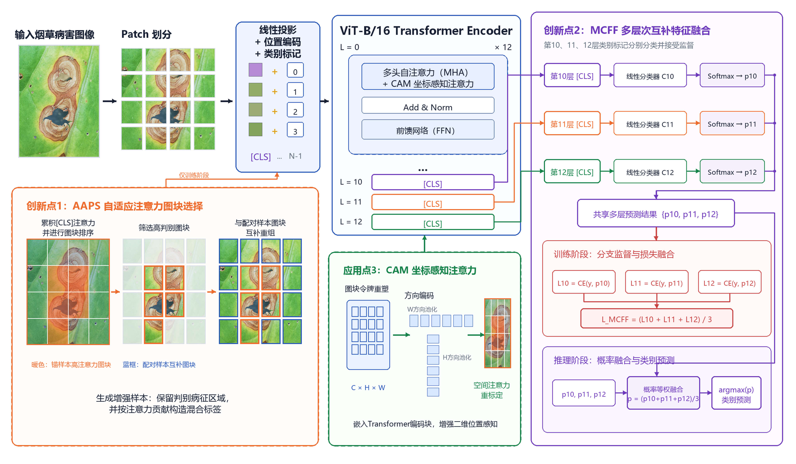
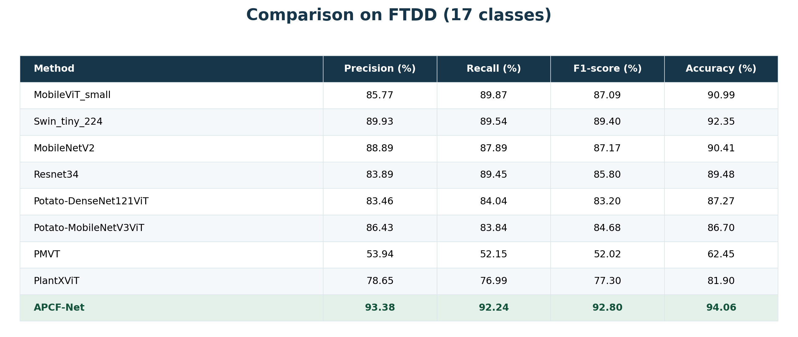

# APCF-Net

**烟草病害细粒度数据集构建与注意力图块互补识别方法**

APCF-Net 是面向田间烟草病害细粒度识别的注意力图块互补融合网络。模型以 ViT-B/16 为主干，结合自适应注意力图块选择（AAPS）、多层次互补特征融合（MCFF）和坐标感知注意力（CAM），在 **FTDD 17类烟草病害数据集**上取得 **94.06%** 的识别准确率。

本仓库提供模型、训练与评估代码。数据集的全部图像及配套 CSV 清单通过下方百度网盘链接提供。

## 数据集

FTDD（Fine-grained Tobacco Disease Dataset）包含 **4,669 张田间图像、17类烟草病害**，采用“侵染类型—发病部位—具体病害”三级标注体系。本仓库的分类任务为17类具体病害识别。

| 下载内容 | 地址 | 提取码 |
|---|---|---|
| FTDD：全部图像及配套 CSV 清单 | [百度网盘下载](https://pan.baidu.com/s/1afgBHVSYO7AT8ubXiCT6rw) | **GZYC** |

请下载并解压网盘中的正式数据集，使用其中提供的 CSV 清单。

### 数据分布



*图1：FTDD 数据集的病害类别分布与各类别样本数量。*

## 方法框架



*图2：APCF-Net 整体框架。*

- **AAPS**：训练时根据累积注意力保留高判别性图块，并与配对样本的高注意力图块互补组合，减少背景干扰。
- **MCFF**：对第10、11、12层类别令牌分别进行分类监督，推理时对三个分支的类别概率等权融合。
- **CAM**：在 Transformer 编码块中引入水平与垂直方向的坐标注意力，增强病斑空间结构的表达。

## 实验结果

以下为论文表2中的实验结果，实验性能已完成验证。所有指标单位为%。



| 方法 | 精确率 | 召回率 | F1分数 | 准确率 |
|---|---:|---:|---:|---:|
| MobileViT_small | 85.77 | 89.87 | 87.09 | 90.99 |
| Swin_tiny_224 | 89.93 | 89.54 | 89.40 | 92.35 |
| MobileNetV2 | 88.89 | 87.89 | 87.17 | 90.41 |
| Resnet34 | 83.89 | 89.45 | 85.80 | 89.48 |
| Potato-DenseNet121ViT | 83.46 | 84.04 | 83.20 | 87.27 |
| Potato-MobileNetV3ViT | 86.43 | 83.84 | 84.68 | 86.70 |
| PMVT | 53.94 | 52.15 | 52.02 | 62.45 |
| PlantXViT | 78.65 | 76.99 | 77.30 | 81.90 |
| **APCF-Net** | **93.38** | **92.24** | **92.80** | **94.06** |

## 环境安装

推荐使用 Python 3.10 和 PyTorch 2.5.1。

```bash
python -m venv .venv
```

激活环境：

```powershell
# Windows PowerShell
.\.venv\Scripts\Activate.ps1
```

```bash
# Linux / macOS
source .venv/bin/activate
```

根据运行设备选择一种 PyTorch 安装方式：

```bash
# NVIDIA GPU，CUDA 12.4版本
python -m pip install torch==2.5.1 --index-url https://download.pytorch.org/whl/cu124

# 或：CPU版本
python -m pip install torch==2.5.1 --index-url https://download.pytorch.org/whl/cpu
```

安装其余依赖：

```bash
python -m pip install -r requirements-paper.txt
```

已有兼容 PyTorch 环境可使用 `requirements.txt`。其他安装组合参考 [PyTorch官方安装说明](https://docs.pytorch.org/get-started/previous-versions/)。

## 数据准备

下载上方网盘中的图像和 CSV 后，在 `configs/paper.json` 中设置对应路径。下面是本仓库约定的目录示例；也可以保留下载后的原有组织方式，通过配置或命令行指定实际位置。

```text
data/
└── tobacco/
    ├── images/               # 全部病害图像，保留CSV对应的相对目录
    ├── train.csv             # 训练集清单
    ├── val.csv               # 验证集清单
    └── test.csv              # 测试集清单
```

CSV 使用 `img_name` 和 `label` 两列，允许存在额外索引列。`img_name` 为相对于图像根目录的路径；标签为连续的17个类别编号。配置默认 `label_base=0`，若下载的 CSV 使用1起始编号，则设置 `label_base=1`。保留正式清单中的类别对应关系。

```csv
img_name,label
class_a/image001.jpg,0
class_b/image002.jpg,1
```

所有命令均在仓库根目录执行。先检查训练/验证清单、标签范围、图像文件及划分交集：

```bash
python train.py --config configs/paper.json --check-data
```

也可直接传入实际路径：

```bash
python train.py --config configs/paper.json --data-root /path/to/images --train-csv /path/to/train.csv --val-csv /path/to/val.csv --check-data
```

## 预训练权重

下载 [Google ViT-B/16预训练权重](https://storage.googleapis.com/vit_models/sam/ViT-B_16.npz)，放入 `weights/ViT-B_16.npz`。加载器使用 Google/JAX 的 `.npz` 格式，也支持通过 `--pretrained` 指定已有文件。

## 训练

```bash
python train.py --config configs/paper.json --pretrained weights/ViT-B_16.npz
```

主要配置如下：

| 参数 | 设置 |
|---|---|
| 主干网络 | ViT-B/16 |
| 病害类别数 | 17 |
| 输入分辨率 | 224 × 224 |
| 训练轮数 | 60 |
| 批大小 | 64 |
| 优化器 / 初始学习率 | Adam / 3e-4 |
| 学习率调度 | 阶梯衰减 |
| AAPS触发概率 | 0.5 |
| MCFF层级 | 第10、11、12层 |
| 三分支融合权重 | 各1/3 |

设备默认自动选择 GPU 或 CPU。可通过 `--batch-size`、`--device`、`--num-workers` 和 `--output-dir` 调整运行设置；例如降低显存需求：

```bash
python train.py --config configs/paper.json --batch-size 4 --output-dir outputs/tobacco-b4
```

训练过程使用验证集选择最佳模型，输出配置快照、训练日志、数据清单指纹，以及 `best.pt` 和 `last.pt`。具体模块与配置说明见 [实现说明](docs/PAPER_ALIGNMENT.md)。

## 恢复训练与测试

```bash
# 从上次完成的轮次继续训练
python train.py --config configs/paper.json --resume outputs/tobacco/last.pt

# 在测试集上评估最佳模型
python evaluate.py --checkpoint outputs/tobacco/best.pt --csv data/tobacco/test.csv --data-root data/tobacco/images --output outputs/tobacco/test_metrics.json
```

恢复训练时，保持原运行的模型配置、数据清单、批大小和总轮数一致，并重复所使用的命令行覆盖参数。测试输出准确率、宏平均精确率/召回率/F1、各类别指标及混淆矩阵；输出 JSON 中指标采用0–1数值。

## 目录说明

```text
APCF-Net/
├── README.md
├── assets/                  # 数据分布图、框架图、实验结果表
├── train.py                 # 训练与恢复
├── evaluate.py              # 测试集评估
├── tobacco.py               # 本地运行检查用的合成样本生成脚本
├── verify_runtime.py        # 自动检查训练、恢复和评估流程
├── configs/
│   ├── paper.json           # FTDD 17类训练配置
│   └── smoke.json           # 轻量运行检查配置
├── apcf/
│   ├── backbone.py          # ViT主干
│   ├── aaps.py              # 注意力图块互补
│   ├── cam.py               # 坐标注意力
│   ├── mcff.py              # 多层监督与概率融合
│   ├── model.py             # APCF-Net完整模型
│   ├── pretrained.py       # 预训练加载
│   ├── data.py              # CSV与图像读取
│   ├── config.py            # 配置读取
│   └── engine.py            # 训练、指标和检查点
├── tests/
└── docs/
```

如需检查环境与训练流程，可执行：

```bash
python verify_runtime.py
```

该命令自动调用 `tobacco.py` 生成合成图片，检查训练、保存、恢复和评估。合成图片仅用于工程检查，正式 FTDD 图像及 CSV 请从网盘下载。再次检查时使用新输出目录，例如 `--output-dir outputs/verification2`。

## 致谢

感谢 [Vision Transformer](https://github.com/google-research/vision_transformer)、[Coordinate Attention](https://github.com/houqb/CoordAttention) 及相关细粒度分类工作的开源实现。代码来源与第三方说明见 [THIRD_PARTY_NOTICES.md](THIRD_PARTY_NOTICES.md)。
